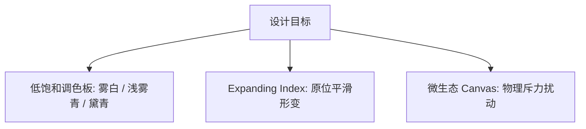

建站最初的动力，来自对目前主流“模板化”博客的疲惫。满屏的浮夸阴影、居中的大号 Hero Banner、五颜六色的徽章，让阅读本身变得充满侵略性。

我想要的很简单：一个安静的、左侧锚定的、有留白和微弱呼吸感的个人刊物空间。

> [!TIP]
> 优秀的个人博客往往是减法做到极致的结果。去除所有非必要组件，把舞台完整留给文字。

在这套主题的设计中，我将主要注意力放在以下三件事上：

1. **雾青与黛青的低饱和调色板**：模仿清晨带有露水与雾气的空气感；
2. **原位自体展开的索引系统（Expanding Index）**：取代生硬的抽屉遮罩；
3. **轻量级的背景生态微交互**：让页面不是静态的死物，而是偶尔有微风吹拂的庭院。
