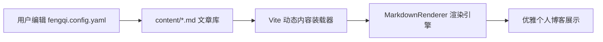
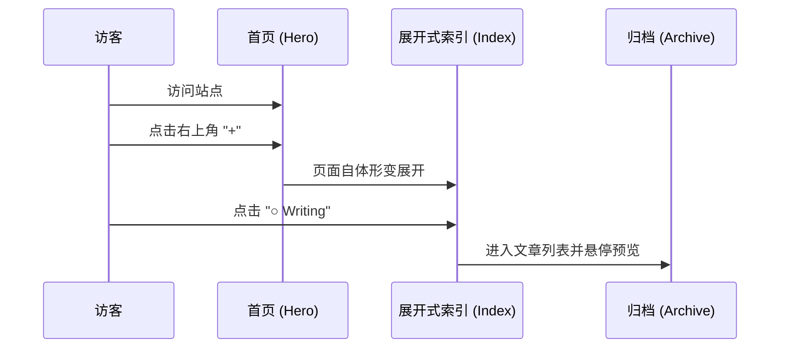

在这个主题中，Markdown 不仅支持基础的纯文本排版，还完整支持**代码语法高亮**、**GitHub 风格 Callout 提示框**、**Mermaid 图表渲染** 以及 **安全 HTML 嵌入**。

---

### 1. 自定义 Callout 提示框 (Note / Tip / Important / Warning / Caution)

> [!NOTE]
> **这是一条 NOTE 提示框**  
> 浅薄荷绿背景，适合用于补充说明、背景知识或轻量提示。

> [!TIP]
> **这是一条 TIP 技巧提示**  
> 用于分享效率技巧、快捷键推荐或最佳实践。

> [!IMPORTANT]
> **这是一条 IMPORTANT 重要信息**  
> 淡雾青背景，用于强调关键注意事项。

> [!WARNING]
> **这是一条 WARNING 警告框**  
> 暖桃色调，温和提醒可能的陷阱或潜在问题。

> [!CAUTION]
> **这是一条 CAUTION 危险警告**  
> 明确提示高风险或不可逆操作。

---

### 2. 代码块高亮与复制 (Code Blocks)

支持带有语言标识的语法高亮，右上方带有专属一键复制按钮与柔和边框：

```typescript
import { useState, useEffect } from 'react';

// 计算两点之间的欧几里得距离与斥力向量
export function calculateRepulsion(
  px: number, 
  py: number, 
  mx: number, 
  my: number, 
  radius: number = 110
) {
  const dx = px - mx;
  const dy = py - my;
  const dist = Math.sqrt(dx * dx + dy * dy);

  if (dist < radius && dist > 0) {
    const force = (1 - dist / radius) * 1.8;
    return { fx: (dx / dist) * force, fy: (dy / dist) * force };
  }
  return { fx: 0, fy: 0 };
}
```

```css
/* 自定义低饱和调色板变量 */
:root {
  --color-fog-white: #F3F6F4;
  --color-slate-deep: #2F4B4D;
  --color-mint: #A7CFC3;
  --color-peach: #F6DCCB;
}
```

---

### 3. Mermaid 架构图与流程图 (Mermaid Diagrams)

直接书写 ` ```mermaid ` 代码块，即可由渲染引擎自动转换为符合主题配色的矢量流程图：





---

### 4. 原生 HTML 嵌入 (HTML Embeds)

你可以直接在 Markdown 中嵌入定制的 HTML 结构，比如音频播放器、进度条或多列网格：

<div style="background: rgba(230, 237, 235, 0.6); padding: 16px 20px; border-radius: 10px; border: 1px dashed #A7CFC3; margin: 20px 0;">
  <span style="font-weight: 500; color: #2F4B4D;">✨ 这是一个内嵌的 HTML 容器</span>
  <p style="margin: 6px 0 0 0; font-size: 14px; color: #5C7A7C;">
    你可以在这里自由嵌入音频 <code>&lt;audio&gt;</code>、视频 <code>&lt;video&gt;</code>、外链卡片或者任何自定义标签。
  </p>
</div>

---

### 5. 标准 GFM 表格与任务清单 (GFM Tables & Task Lists)

| 功能特性 | 支持状态 | 说明 |
| :--- | :---: | :--- |
| **代码高亮** | ✅ 支持 | 带语言标签与一键复制 |
| **Callout 提示框** | ✅ 支持 | Note / Tip / Warning / Caution / Important |
| **Mermaid 图表** | ✅ 支持 | 流程图、时序图、甘特图等 |
| **HTML 嵌入** | ✅ 支持 | 安全过滤与自定义组件嵌入 |
| **数学公式** | ✅ 支持 | LaTeX 内联与块级公式 |

- [x] 搭建好全局 YAML 配置文件
- [x] 支持在 `content/posts/` 中随意添加 `.md` 文章
- [x] 在右侧享受即时 Hover 聚焦预览
